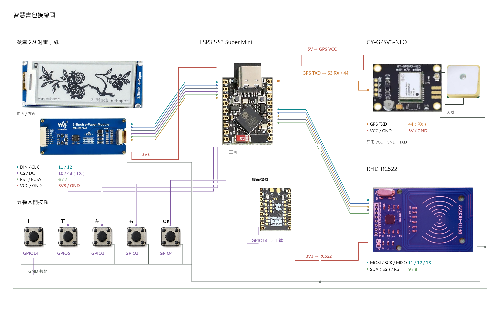
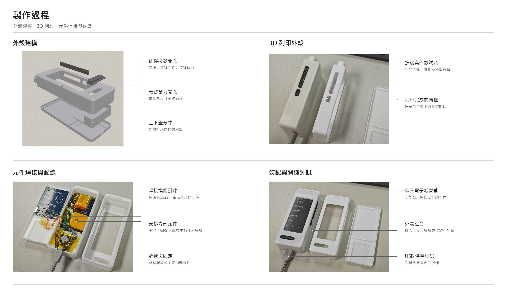

# 智慧電子課表書包 Smart Schoolbag

以 **ESP32-S3 Super Mini + 微雪 2.9 吋電子紙 + RC522 + NEO-6M GPS + 五鍵**，搭配 **Flutter 手機 App** 的離線電子課表與物品檢查原型。手機管理物品、星期清單、課表、日期記事及便利貼，透過書包本地 Wi-Fi 同步到裝置。

這是 **v1.5.0 原始碼交接基線**，不是已完成所有驗收的商用產品。韌體先前已成功燒錄並啟動；手機 v1.5.0+15 已建置，該版雙端實機驗收仍未完成。GPS 接收到有效 NMEA，但最後紀錄仍為 NO FIX。詳細狀態見 [功能與待辦](docs/FEATURES.md)。

## 接手從這裡開始

1. AI／開發者先讀 [AGENTS.md](AGENTS.md) 與 [完整交接](docs/HANDOFF.md)。
2. 組裝前讀 [接線與供電](docs/HARDWARE.md)，不可套用一般 ESP32 的預設 SPI 腳位。
3. 依 [建置與執行](docs/BUILD.md) 安裝工具鏈、執行測試與編譯；預設腳本都不燒錄、不安裝手機。
4. 修改同步時，同時閱讀 [協定](docs/PROTOCOL.md) 與雙端實作。
5. 按 [驗收清單](docs/TESTING.md) 記錄真實結果；禁止用編譯成功代替硬體驗收。

本次交接的分析、測試、建置與公開下載驗證見 [驗證紀錄](docs/VALIDATION.md)。

## 專案結構

```text
firmware/EPaperTest/          Arduino C++ 韌體與內嵌 MFRC522、TinyGPSPlus
mobile/SmartSchoolbagApp/    Flutter App、Android/iOS 殼層與資料邏輯測試
scripts/                    可攜式建置、檔案完整性檢查與字庫產生工具
docs/                       接線、協定、狀態、需求、驗收與 AI 交接
docs/images/                修正過的兩張 PNG、原始製作實照與外殼建模圖片
SOURCE-MANIFEST.json        來源路徑與 SHA-256；記錄基線及公開版移除密碼的差異
```

主要來源：`firmware/EPaperTest/EPaperTestApp.h`、`PanelConfig.h`、`GpsSupport.h`；手機主要邏輯目前集中於 `mobile/SmartSchoolbagApp/lib/main.dart`，Android Wi-Fi 平台通道在 `android/app/src/main/kotlin/tw/smartschoolbag/smart_schoolbag_app/MainActivity.kt`。

## 操作與連線

- 上／下移動，OK／右鍵確認，左鍵返回上一層；物品清單 OK 勾選、右鍵翻頁。
- 要帶物品先選星期一至日，離線也能操作；便利貼可進入標題與內容頁。
- OK 按住滿 1.5 秒顯示 POWER OFF，再進深睡；按住喚醒與 USB 喚醒須依板型驗收。
- 手機加入 `SmartSchoolbag`，密碼由本機 LocalWifiConfig.h 設定，裝置 `http://192.168.4.1`。該 AP 沒有網際網路。
- App 前景修改後自動同步；不保證 App 被關閉後的背景同步。沒有雲端帳號或遠端家長追蹤。
- 電池資訊依需求移除。不得加入虛構電量、虛構 GPS 或不存在的斷電能力。

## 硬體與製作圖片





兩張 PNG 已移除底部製圖說明，沒有新增標註。接線圖線端為概略位置，GPIO 以接線表和實物絲印為準；GPS 5V 僅適用本案已確認的載板。

## 交付範圍

本庫保留可編譯的完整目前來源、依賴鎖檔、第三方來源與圖片，不收錄過往每一版 APK／BIN、工具快取、個人位置日誌、手機資料備份、簽章金鑰或本機絕對路徑設定。建置可重新產生 APK 和韌體。iOS 專案殼層已收錄，但未在 macOS/Xcode 驗證。

第三方授權見 [THIRD_PARTY_NOTICES.md](THIRD_PARTY_NOTICES.md)。本次未替使用者擅自選定整體開源授權；公開程式儲存庫不等同授權公開再散布。


