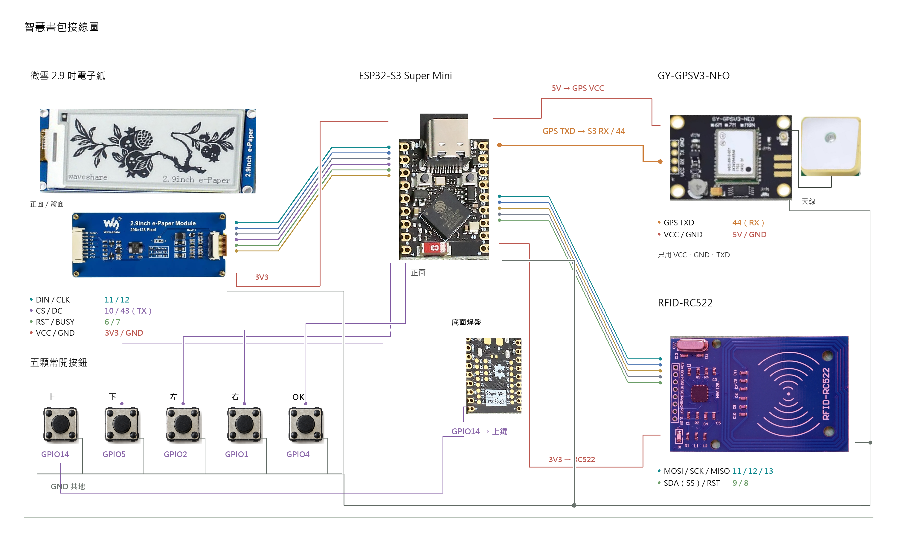
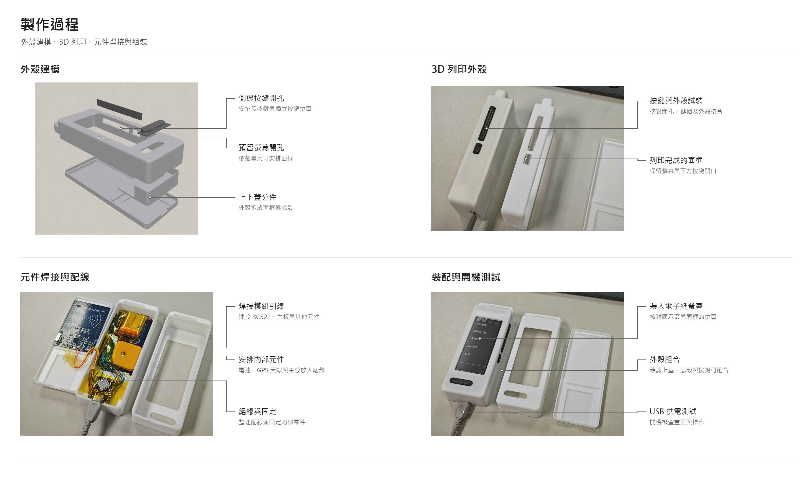

# 接線、供電與板型

數字都是 ESP32 GPIO 編號，不是排針順序。全部 GPIO 訊號是 3.3V，所有 GND 共地。對照來源：PanelConfig.h 與 EPaperTestApp.h 的 BUTTON_PINS。

| 模組 | 模組腳位 | ESP32 接點 |
|---|---|---|
| 微雪 2.9 吋 EPD | VCC / GND | 3V3 / GND |
| EPD | DIN / CLK | GPIO11 / GPIO12 |
| EPD | CS / DC | GPIO10 / GPIO43（外圍 TX） |
| EPD | RST / BUSY | GPIO6 / GPIO7 |
| RC522 | 3.3V / GND | 3V3 / GND；禁止接 5V |
| RC522 | MOSI / SCK / MISO | GPIO11 / GPIO12 / GPIO13 |
| RC522 | SDA（SPI SS）/ RST | GPIO9 / GPIO8 |
| RC522 | IRQ | 不接 |
| GY-GPSV3-NEO 6M 載板 | TXD | GPIO44（外圍 RX），UART1 RX |
| GPS | GND | GND |
| GPS | VCC | 本案最後確認接 5V，僅限已確認載板額定允許 |
| 上鍵 | 一端 / 另一端 | GPIO14 / GND |
| 下鍵 | 一端 / 另一端 | GPIO5 / GND |
| 左鍵 | 一端 / 另一端 | GPIO2 / GND |
| 右鍵 | 一端 / 另一端 | GPIO1 / GND |
| OK 鍵 | 一端 / 另一端 | GPIO4 / GND |

按鍵使用 INPUT_PULLUP，按下為 LOW。四腳輕觸開關先用電表確認哪兩腳本來相通，接按下才導通的兩組。GPIO14 位於本案 Nologo 板底面焊盤，需另外焊線。GPS 只需 VCC/GND/TXD；三線訊號若其實是 PPS，就不能當 UART TXD。

## 匯流排與保留腳

- SPI.begin(12,13,11,-1)，EPD 與 RC522 的 CS/RST 各自獨立；兩個 CS 可各用 10kΩ 上拉至對應 3.3V 軌。
- GPIO43 已用 EPD DC，禁止 UART0 日誌干擾；除錯走 USB CDC。GPIO44 給 GPS，不作一般串列除錯。
- GPIO19/20 保留原生 USB；GPIO0/3/45/46 不接外部按鈕或模組。
- GPIO3 在已核對的 Nologo 版經板載分壓偵測 USB VBUS，僅作輸入；不同複刻板不可直接套用。
- GPIO15 底面焊盤預留負載開關控制，PERIPHERAL_POWER_GATE_ENABLED 預設 0。沒有實際開關時不要啟用。

## 供電

先用可靠 USB 5V 電源，RC522／電子紙接穩定 3.3V。GPS 本案使用含穩壓的 6M 載板，最後接 5V 收到 NMEA；裸 NEO-6M 不是 5V 元件，GPS TXD 也不能輸出 5V 到 ESP32。複刻板要先核對額定值。電池模式不可假定主板 5V 腳仍有 5V；必要時另規劃升壓與電源開關。

線路應短，SPI 建議約 10cm 內，供電預留適當去耦。若 RC522 燈暗、重啟或 EPD 不更新，先量 VCC/GND、短路與壓降，再核對共用 SPI 和片選；不可關閉 brownout 掩蓋問題。

深睡只停止晶片／UART／RF／IO，不代表切掉外設 VCC。真正斷電需 3.3V、5V 各自負載開關並防訊號反向供電。USB 插入喚醒依板載 VBUS 偵測，且深睡時 USB CDC 會斷線；需真實驗收，不能保證任意複刻板通用。

## 面板與 GPS

EPAPER_PROFILE 預設 1：GxEPD2_290_T94_V2，假設 GDEM029T94／SSD1680 黑白板。實物尚未由背面型號核實。尺寸 2.9 吋／296×128 不足以判定控制器；其他 profile 的顏色、BUSY、LUT 都不同。CONFIRMED_GDEM029T94 預設 0，未知面板不套四階灰階波形。

GPS UART 起始 9600 8N1，韌體有偵測與診斷。陶瓷白／米色面朝天空平放，扣緊同軸 RF 接頭，天線不必黏在板上。NMEA 有資料但 NO FIX 時檢查衛星／訊號／供電／天線與戶外環境，不可把 GPS fix 設為真來假修復。

圖中線端是概略標示，最終仍以表格與實物絲印為準。附圖包含外殼建模畫面與實照，沒有可編輯 CAD／STL 原檔，不能從截圖宣稱已交付可列印模型。

